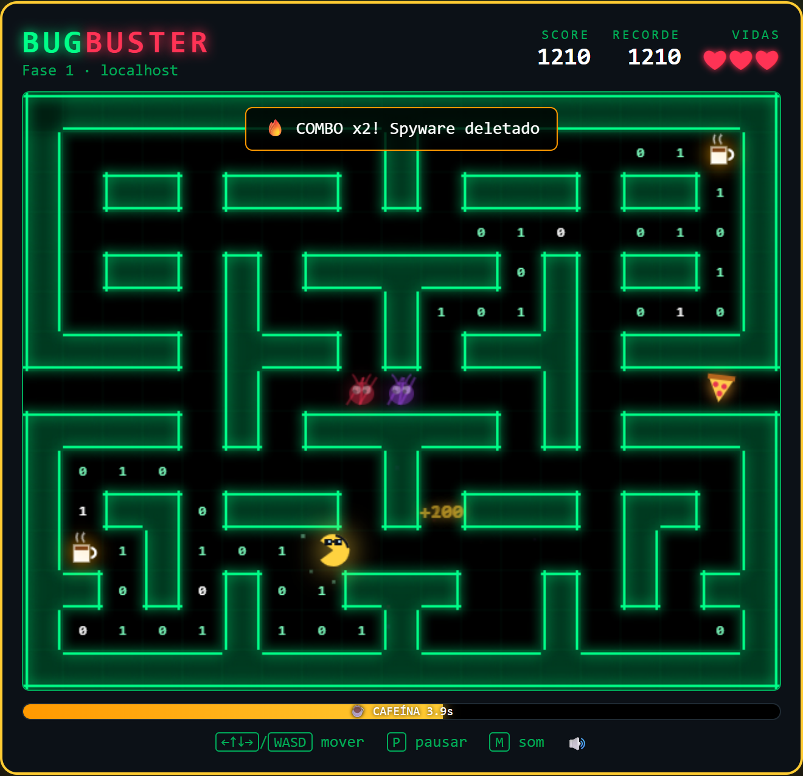

# Bug Buster 🐛☕

Um jogo retro-cyberpunk 2D de labirinto, desenvolvido inteiramente com as tecnologias base da Web (**HTML5, CSS3 e JavaScript Vanilla**), sem dependência de bibliotecas externas ou frameworks.



## 🎮 Como Jogar
- **Objetivo:** Colete todas as *Linhas de Código* (os bits `0` e `1`) do servidor para avançar de fase.
- **Movimentação:** Setas do teclado ou **WASD**. O programador anda sozinho na direção escolhida e a próxima curva fica "guardada" até ser possível virar. No celular, use o D-pad na tela ou deslize o dedo.
- **Vidas:** Você começa com 3 ❤ e ganha uma vida extra a cada 5.000 pontos (máximo de 5).
- **Inimigos (bugs):**
  - 🔴 **Ransomware** — persegue você pelo caminho mais curto (BFS).
  - 🟣 **Spyware** — vaga aleatoriamente, mas às vezes resolve te seguir.
  - 🩷 **Trojan** (fase 2+) — tenta chegar 4 casas **à frente** de você para te emboscar.
  - 🩵 **Worm** (fase 3+) — patrulha e só te persegue quando você chega perto.
- **Itens:**
  - ☕ **Café** — invencibilidade temporária. Devore bugs com combo: 100 → 200 → 400 → 800 → 1600!
  - ⏸ **Breakpoint** — congela todos os bugs por 4 segundos.
  - 🍕 **Pizza da madrugada** — aparece por tempo limitado e vale +500.
- **Túneis:** Saia pelas laterais do mapa para reaparecer do lado oposto.
- **Fases:** `localhost` → `staging` → `PRODUÇÃO` (sexta-feira, 17h59). A cada fase os bugs ficam mais rápidos e o café dura menos.
- **Atalhos:** `P`/`Esc` pausa, `M` liga/desliga o som, `Enter` confirma.
- 🤫 Tente o código Konami: `↑ ↑ ↓ ↓ ← → ← → B A`.

## 🛠️ Tecnologias Utilizadas
- **HTML5 Canvas:** Renderização 2D a 60 FPS, com sprites desenhados por código (programador, bugs, café, pizza).
- **CSS3 (Flexbox/Grid):** HUD, menus, animações (glitch, shake) e efeito *Neon/Glow*.
- **JavaScript (ES6):** Arquitetura separada entre *Lógica* (`logic.js`) e *Renderização/Loop* (`game.js`).
- **Web Audio API:** Efeitos sonoros e trilha chiptune gerados em tempo real, sem arquivos de áudio.
- **localStorage:** Top 5 recordes salvos no navegador.

## 📁 Estrutura do Projeto
- `index.html`: Canvas, HUD e telas de menu, pausa, vitória e game over.
- `style.css`: Estética de terminal hacker neon e layout responsivo.
- `logic.js`: Classe `GameLogic` pura — mapas, movimento, IA dos bugs, itens, vidas e pontuação (testável no Node).
- `game.js`: Loop com `requestAnimationFrame` + passo fixo de 60 ticks/s, desenho, partículas, áudio e entrada.
- `test.js` / `test.html`: Testes automatizados da lógica.
- `docs/telas/`: Capturas de tela usadas na documentação.
- `Documentacao_BugBuster.docx`: Documentação de projeto Frontend.

## 🚀 Como Executar
Abra o arquivo `index.html` em qualquer navegador moderno. Não requer servidor, Node.js ou bundler.

### Testes
```bash
node test.js
```
Ou abra `test.html` no navegador.

---
*Projeto desenvolvido para a disciplina de Aplicações Front End — UniProjeção.*
